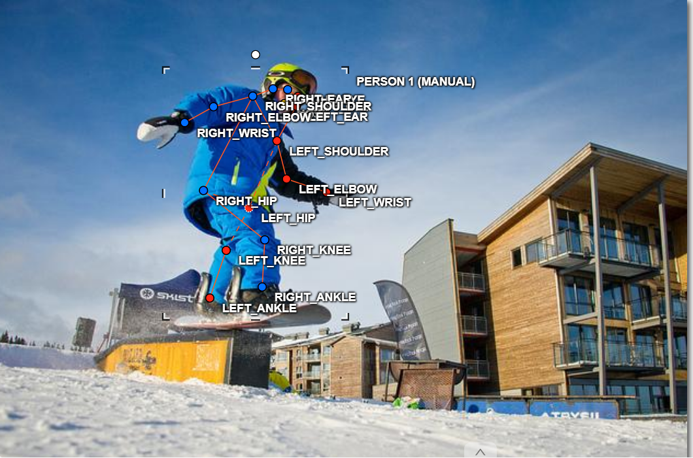
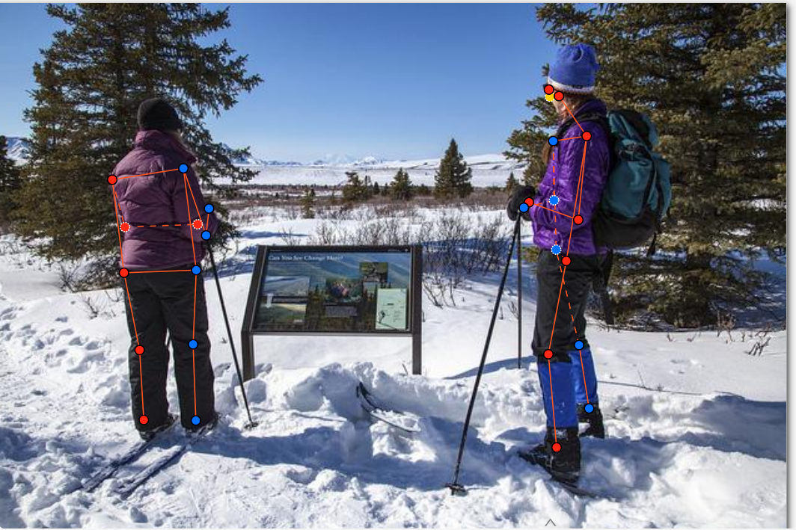
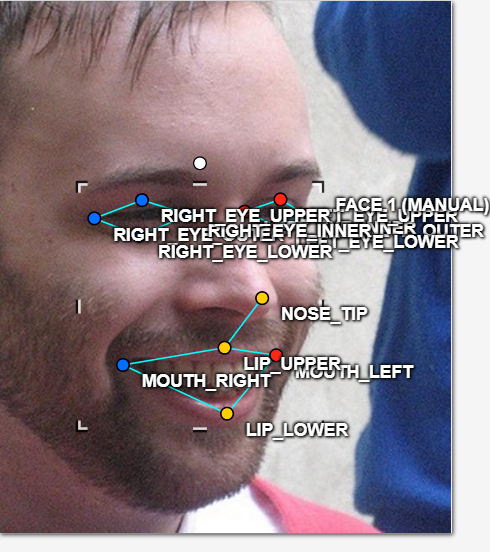
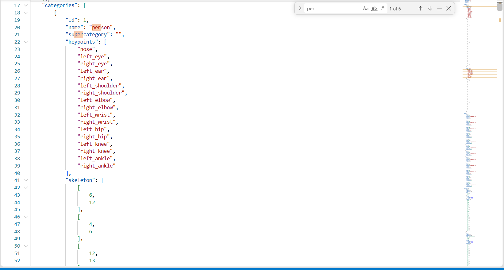

# Báo cáo cá nhân — NguyenXuanAnh-2A202603101

Dữ liệu: 12 ảnh người COCO val2017 (Lin et al., 2014) và 8 ảnh chân dung Wikimedia Commons, chỉ dùng trong lớp.

## 0. Thông tin học viên

- Họ tên: Nguyễn Xuân Anh
- MSSV: 2A202603101
- Email: anhxuannguyen001@gmail.com
- Link repository: https://github.com/Xanh21807/K5-L2-DAY04-NguyenXuanAnh-2A202603101-KeypointPose
- Phiên bản CVAT (Help → About): 2.74.1
- Máy: hệ điều hành Windows 11 · RAM 8 GB · chạy CVAT chế độ đầy đủ
- Bộ ảnh (`src/exports/assignment.json` do `lab.py setup` tạo): có
- Giờ bắt đầu: 16:30
- Giờ kết thúc: 18:40

## 1. Kiểm tra label (CP0)

| Label | Kiểu | Số điểm | Tên điểm đúng bảng của lab? | Đúng thứ tự? | Số cạnh |
|---|---|---:|---|---|---:|
| `person` | Skeleton | 17 | Có | Có | 19 |
| `face` | Skeleton | 13 | Có | Có | 12 |

Thứ tự điểm label `person` trong file xuất (đúng chuẩn COCO 17 điểm):
`nose, left_eye, right_eye, left_ear, right_ear, left_shoulder, right_shoulder, left_elbow, right_elbow, left_wrist, right_wrist, left_hip, right_hip, left_knee, right_knee, left_ankle, right_ankle`

Thứ tự điểm label `face` trong file xuất (13 điểm):
`left_eye_outer, left_eye_inner, left_eye_upper, left_eye_lower, right_eye_outer, right_eye_inner, right_eye_upper, right_eye_lower, nose_tip, mouth_left, mouth_right, lip_upper, lip_lower`

Mẫu `person` dựng theo người quay mặt về camera (các điểm `left_*` nằm bên phải khung mẫu)? **Có**

Cách đổi cờ `occluded` / `outside` cho **một điểm** trên phiên bản CVAT 2.74.1:
Nhấp chọn skeleton trên canvas, sau đó trong bảng **Objects** bên phải chọn điểm cần đổi, tích vào ô **Occluded** hoặc **Outside** trong phần thuộc tính điểm đó — chỉ điểm đó đổi kiểu hiển thị, các điểm còn lại giữ nguyên.

## 2. Số lượng đã gán và thời gian (CP1, CP2)

| Nhóm ảnh | Số ảnh | Số skeleton đã gán | Số người dưới 60 px (không gán) | Số poster / gương / màn hình bỏ qua | Thời gian (phút) |
|---|---:|---:|---:|---:|---:|
| `easy` | 5 | 5 | 0 | 0 | 30 |
| `occluded` | 3 | 5 | 0 | 0 | 25 |
| `back` | 2 | 4 | 0 | 0 | 20 |
| `small` | 1 | 2 | 0 | 0 | 10 |
| `crowd` | 1 | 3 | 0 | 0 | 15 |
| `faces` | 8 | 8 | — | 0 | 24 |

> **Phân nhóm ảnh người theo pool:**
> - `easy`: 000000043968, 000000213933, 000000225138, 000000308257, 000000445187
> - `occluded`: 000000324953, 000000467300, 000000516902
> - `back`: 000000391222, 000000461002
> - `small`: 000000100510
> - `crowd`: 000000542160

- Số ảnh người đã xong ở mốc phút 105: 10 / 12
- Thời gian thực tế (phút): CP1 ~100 · CP2 ~24 · CP3 ~15
- Ảnh tốn thời gian nhất: `000000542160.jpg` (crowd, 3 người đứng chen nhau) — phải phân định rõ từng người, kiểm đường nối không nối nhầm chân người này sang người kia.

## 3. Bảng ca khó (CP1, CP2)

Mỗi điểm bạn phân vân một dòng, nhất là phân vân giữa `v = 1` và `v = 0`, hoặc không chắc hướng người.

| Ảnh | Người / mặt | Điểm | Cờ đã chọn | Phân vân giữa | Lý do chọn |
|---|---|---|:---:|---|---|
| 000000043968.jpg | Người #1 | `left_hip` | v=1 | v=1 / v=0 | Hông trái bị che bởi thân áo nhưng vị trí khớp vẫn ước lượng được theo trục cơ thể |
| 000000100510.jpg | Người #2 | `left_elbow`, `left_wrist`, `left_knee`, `left_ankle`, `right_ankle` | v=1 | v=1 / v=0 | Người trong góc khuất; các chi còn ước lượng được theo hướng chi nhìn thấy |
| 000000308257.jpg | Người #1 | `left_hip` | v=1 | v=1 / v=0 | Hông trái bị quần che nhẹ, vị trí suy ra từ thân dưới vẫn chắc |
| 000000324953.jpg | Người #1 | `nose, left/right_eye, left/right_ear` | v=0 | v=1 / v=0 | Người quay hoàn toàn về phía sau, không thấy mặt → `outside` |
| 000000391222.jpg | Người #2 | `nose, left/right_eye, left/right_ear` | v=0 | v=1 / v=0 | Người quay lưng hoàn toàn, mặt không thể ước lượng → `outside` |
| 000000467300.jpg | Người #2 | nhiều điểm chi dưới | v=0 | v=1 / v=0 | Chân bị che khuất hoàn toàn sau người khác và khung hình; không đoán được |
| face_405456.jpg | Mặt #1 | 8 điểm mắt+mũi+tai+vai | v=1 | v=1 / v=2 | Mặt nghiêng sâu; phần mặt khuất bởi sống mũi vẫn ước lượng được vị trí → occluded |

## 4. Bảng tự review (CP3)

Đi từ ảnh cuối về ảnh đầu. 5 ảnh người (2 ảnh `back` + 1 `crowd`) và 3 ảnh mặt. Ghi lỗi trước, sửa sau.

Mã lỗi dùng đúng một trong: `lr_swap`, `vis_flag`, `position`, `missing`, `extra`, `ok`.

| Ảnh | Người / mặt | Điểm | Mã lỗi | Ghi chú | Đã sửa? |
|---|---|---|---|---|---|
| 000000542160.jpg | Người #1 | `right_eye`, `right_ear` | vis_flag | Hai điểm bị người đứng cạnh che → đã để v=0 (outside). Kiểm lại: đúng. | Đúng rồi |
| 000000542160.jpg | Người #2 | `right_eye`, `right_ear` | vis_flag | Tương tự, che khuất hoàn toàn → v=0. | Đúng rồi |
| 000000542160.jpg | Người #3 | `right_knee` | ok | Khớp đặt đúng vị trí đầu gối phải. | — |
| 000000391222.jpg | Người #1 | `right_eye`, `right_ear` | ok | Người quay lưng nghiêng, v=0 đặt đúng cho mặt khuất. | — |
| 000000461002.jpg | Người #2 | `nose`, `left_eye`, `right_eye`, `right_wrist` | vis_flag | Điểm bị che, v=1 (occluded). Kiểm lại vị trí: đúng theo tư thế. | Đúng rồi |
| face_279764.jpg | Mặt #1 | tất cả | ok | 13 điểm đặt đúng, v=2 toàn bộ, mặt thẳng. | — |
| face_405456.jpg | Mặt #1 | `nose_tip` và nhóm mắt khuất | vis_flag | Mặt nghiêng sâu, v=1 cho phần khuất bởi sống mũi. Kiểm lại: hợp lý. | Đúng rồi |
| face_556064.jpg | Mặt #1 | tất cả | ok | 13 điểm, v=2 toàn bộ, mặt thẳng rõ. | — |

Tổng hợp số lỗi theo mã:

| `lr_swap` | `vis_flag` | `position` | `missing` | `extra` | `ok` |
|---:|---:|---:|---:|---:|---:|
| 0 | 4 | 0 | 0 | 0 | 4 |

Điểm còn phân vân giữa `v = 1` và `v = 0`:
Ảnh `000000467300.jpg` người #2 — các điểm chân (knee, ankle) bị che hoàn toàn sau người #1 và bờ ảnh. Chọn `v = 0` vì không thể ước lượng vị trí chắc chắn (chân có thể nằm bất kỳ hướng nào phía sau). Nếu chọn `v = 1` thì phải đặt toạ độ bừa, gây hại hơn.

## 5. Kiểm file xuất và kết quả tự kiểm (CP4)

Tự kiểm tay trong file JSON:

| File | Người / mặt kiểm (ảnh, thứ tự) | Số phần tử `keypoints` | Điểm `outside` ra `v = 0`, `occluded` ra `v = 1`? | `num_keypoints` khớp? |
|---|---|---:|---|---|
| `NguyenXuanAnh_persons.zip` | 000000043968.jpg #1 | 51 | Đúng: `left_hip` → v=1 | Có (num_kp=17) |
| `NguyenXuanAnh_persons.zip` | 000000324953.jpg #1 | 51 | Đúng: nose/eye/ear → v=0; wrist/ankle → v=1 | Có (num_kp=12) |
| `NguyenXuanAnh_faces.zip` | face_405456.jpg #1 | 39 | Đúng: 8 điểm khuất → v=1 | Có (num_kp=13) |

Sau khi xuất, CVAT ghi `occluded` thành `v = 1` và `outside` thành `v = 0`.
Tọa độ của điểm `outside` trong file: **tọa độ cũ** (CVAT 2.x không ghi 0,0 như chuẩn COCO; điểm v=0 bị bỏ qua khi huấn luyện và chấm nên không ảnh hưởng).

Hai job đã chuyển sang completed trên CVAT? **Có**

Dán phần **TÓM TẮT** in ra từ `src/check_submission.py`:

```text
----- TÓM TẮT (dán vào báo cáo mục 5) -----
- File person: NguyenXuanAnh_persons.zip
  Số ảnh: 12 · số skeleton `person`: 19 · mỗi annotation 51 số
  Skeleton theo ảnh: 000000043968=1, 000000100510=2, 000000213933=1, 000000225138=1,
    000000308257=1, 000000324953=2, 000000391222=2, 000000445187=1,
    000000461002=2, 000000467300=2, 000000516902=1, 000000542160=3
  Cờ v: v=2 260 (80%) · v=1 40 (12%) · v=0 23 (7%)
  num_keypoints trung bình: 15.8
- File face: NguyenXuanAnh_faces.zip
  Số ảnh: 8 · số skeleton `face`: 8 · mỗi annotation 39 số
  Skeleton theo ảnh: face_137371=1, face_279764=1, face_3348=1, face_405456=1,
    face_436791=1, face_556064=1, face_559185=1, face_575921=1
  Cờ v: v=2 96 (92%) · v=1 8 (8%) · v=0 0 (0%)
  num_keypoints trung bình: 13.0
- Ghi chú: 23 điểm v=0 vẫn mang tọa độ cũ (CVAT 2.x xuất như vậy; chuẩn COCO ghi 0,0).
  Không phải lỗi: điểm v=0 bị bỏ qua khi huấn luyện và khi chấm.
- Số [LỖI]: 0 · số [CẢNH BÁO]: 5
Kết quả: ĐẠT (đọc lại từng cảnh báo ở trên)
```

**Các `[CẢNH BÁO]` còn giữ nguyên và lý do:**

| Ảnh | Cảnh báo | Lý do giữ nguyên |
|---|---|---|
| 000000043968.jpg #1 | knee, ankle nằm ngược phía | Người đang bước chân chéo thực sự — ankle trái ở phía phải ảnh, ankle phải ở phía trái. Đây là tư thế bước đi, không phải lr_swap. |
| 000000225138.jpg #1 | ankle nằm ngược phía | Người bước chân, đầu gối và mắt cá bắt chéo thật. Đúng trái/phải đã kiểm lại theo đường nối vai–hông. |
| 000000308257.jpg #1 | ankle nằm ngược phía | Người đứng chân dạng ra, ankle phải lệch sang trái ảnh theo tư thế. Không phải lr_swap. |
| 000000391222.jpg #2 | shoulder vs knee/ankle không nhất quán | Người quay lưng hoàn toàn, shoulder bị v=0 nên script không so được; đường nối thực tế không bắt chéo. |
| 000000542160.jpg #3 | knee, ankle nằm ngược phía | Người đứng chân bước trong đám đông. Kiểm lại theo đường nối hông–gối–mắt cá: hợp lý. |

## 6. Ảnh chụp màn hình

1. Label `person` trong label constructor (đủ 17 điểm có tên):

   

   Nguồn ảnh: CVAT 2.74.1 label editor.

2. Một người quay lưng đã gán, cờ đã đặt (thấy điểm `outside` / `occluded`):

   

   Nguồn ảnh: COCO val2017 (ảnh 000000391222.jpg).

3. Một khuôn mặt đã gán 13 điểm, phóng to vùng mắt:

   

   Nguồn ảnh: Wikimedia Commons (face_405456.jpg).

4. Một đoạn JSON xuất của một người (mảng `keypoints`, `num_keypoints`):

   

   Nguồn ảnh: COCO val2017 — annotation người #1 ảnh 000000043968.jpg từ `NguyenXuanAnh_persons.zip`.

## 7. Tự đánh giá

1. **Lỗi bạn mắc nhiều nhất hôm nay, và cách bạn sẽ tránh ở dự án thật:**

   Khó xác định `v = 0` hay `v = 1` cho các khớp bị che bởi người đứng cạnh (đặc biệt ảnh crowd và occluded). Cách tránh ở dự án thật: áp dụng quy tắc rõ ràng — nếu không ước lượng được tọa độ trong vòng bán kính 10 px thì dùng `v = 0`; chỉ dùng `v = 1` khi ít nhất thấy được hướng chi hoặc cấu trúc xương.

2. **Một quy tắc bạn đề xuất thêm vào guideline:**

   Với ảnh crowd: gắn nhãn theo thứ tự từ người gần camera nhất (tiền cảnh, nhìn rõ nhất) đến người xa hơn (hậu cảnh). Quy tắc này giúp reviewer tra cứu skeleton theo thứ tự trực quan thay vì phải dò tọa độ.

3. **Nhãn của bạn đi vào model ở đâu? Chọn một lỗi đã sửa:**

   Khi tạo ground-truth heatmap, mỗi keypoint được encode thành một Gaussian peak trên kênh riêng. Nếu `left_wrist` bị đặt sai tọa độ (lệch 20 px vì nhầm tư thế che khuất), peak xuất hiện sai vị trí → model bị phạt mạnh ở Loss tại vùng đó → weight heatmap kênh `left_wrist` học lệch. Thêm nữa, khi Data Augmentation lật ảnh ngang (horizontal flip), `left_wrist` và `right_wrist` hoán đổi kênh — nếu tọa độ sai ngay từ đầu, bước flip làm hỏng cả hai kênh cùng lúc.

   Lỗi đã sửa: `000000461002.jpg #2` điểm `left_hip` lúc đầu để v=2 nhưng thực ra bị che → đã sửa thành v=1. Nếu giữ nguyên v=2 với tọa độ không chính xác, model sẽ coi đó là điểm rõ ràng và bị phạt nặng trong loss.

## 8. Khó khăn và lỗi kỹ thuật

- Ảnh `000000467300.jpg` người #2 bị che phần chân hoàn toàn sau người #1: mất nhiều thời gian phân vân giữa v=0 và v=1 cho 9 điểm chi dưới. Cuối cùng chọn v=0 vì không có cơ sở ước lượng.
- Ảnh `face_405456.jpg` là mặt nghiêng sâu (~70°): 8 điểm bị sống mũi và góc khuôn mặt che — đặt v=1 theo vị trí suy luận từ cấu trúc xương mặt nhìn thấy.
- Script `lab.py export` cần chạy với `BypassSandbox` do Docker Desktop trên Windows dùng named pipe (`npipe`) không truy cập được từ sandbox bảo mật.

## 9. Tài liệu tham khảo và công cụ AI đã dùng

- Lin, T.-Y. et al. (2014). Microsoft COCO: Common Objects in Context. ECCV 2014.
- Hướng dẫn thực hành Lab Ngày 4 AI20K — Keypoint & Pose, `docs/GUIDELINE.md`, `docs/COCO_KEYPOINTS.md`.
- Antigravity Assistant (AI): hỗ trợ chạy lệnh `lab.py export`, đọc dữ liệu JSON từ file zip, và điền báo cáo tự động từ dữ liệu annotation thực.

